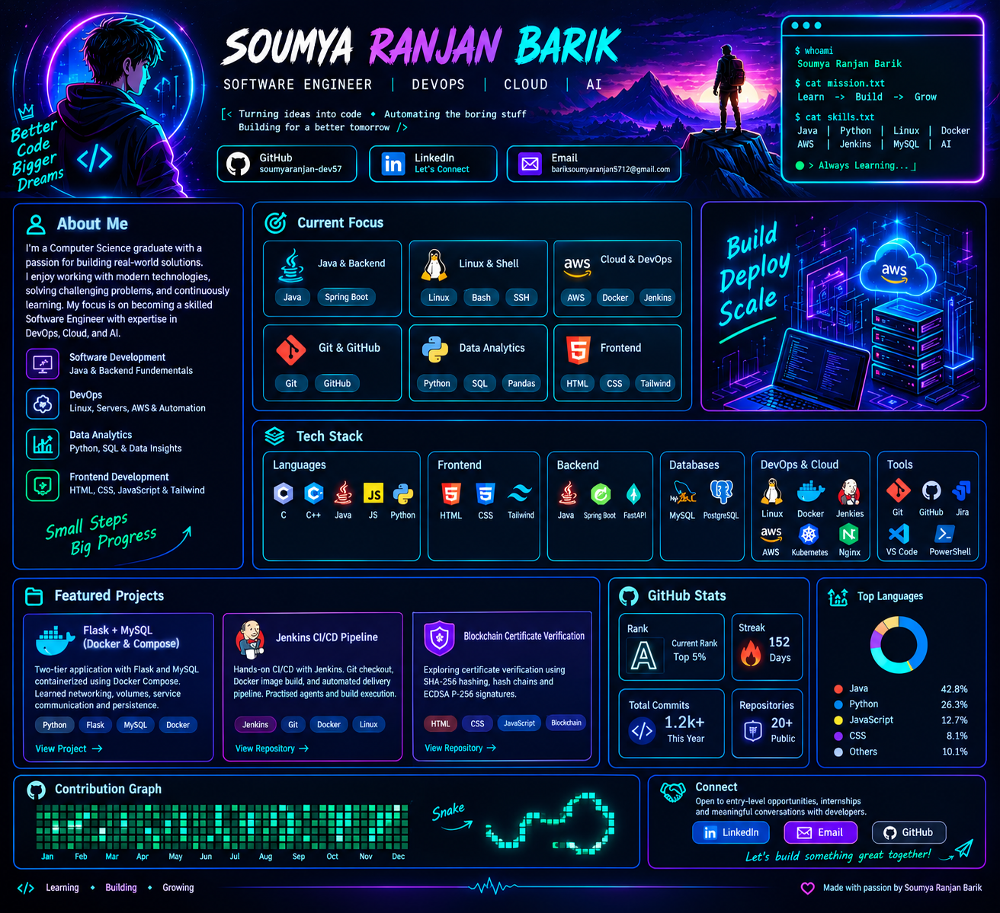

 <div align="center">



# SOUMYA RANJAN BARIK

### `SOFTWARE ENGINEER` · `DEVOPS & CLOUD` · `AI EXPLORER`

**Building skills. Automating workflows. Exploring what's next.**

[](https://github.com/soumyaranjan-dev57)
[](https://www.linkedin.com/in/soumyarani-barik-575b65363/)
[](mailto:bariksoumyaranjan5712@gmail.com)

</div>

---

## `01` // SYSTEM PROFILE

```text
USER       : Soumya Ranjan Barik
ROLE       : Computer Science Graduate
MISSION    : Learn → Build → Automate → Grow
INTERESTS  : Software Engineering | DevOps | Cloud | AI
STATUS     : Learning, building, and improving every day
```

Computer Science graduate focused on software engineering, DevOps, cloud technologies, and AI. I enjoy turning concepts into practical projects and learning how applications are built, containerized, automated, and deployed.

---

## `02` // CURRENT OPERATIONS

| `DOMAIN` | `FOCUS` |
|---|---|
| ☁️ **Cloud & DevOps** | AWS · CI/CD · Jenkins · Terraform · Kubernetes |
| 🐳 **Containers** | Docker · Docker Compose · Container Networking |
| 💻 **Programming** | Python · Java Fundamentals · SQL |
| 🤖 **Artificial Intelligence** | ML Foundations · LLMs · Generative AI · RAG · Agentic AI |

---

## `03` // TECHNOLOGY ARSENAL

<div align="center">

**LANGUAGES**


**DEVOPS & INFRASTRUCTURE**


**DEVELOPMENT & DATABASES**


</div>

---

## `04` // PROJECT ARCHIVE

### 🐳 Flask + MySQL — Containerized Application

> A two-tier web application using Flask and MySQL, connected through Docker Compose.

- Dockerized application and database services
- Container networking and service communication
- Persistent MySQL storage using Docker volumes

[**↗ OPEN REPOSITORY**](https://github.com/soumyaranjan-dev57/flask-mysql-docker-compose)

---

### ⚙️ Jenkins — CI/CD Pipeline Practice

> Hands-on pipeline practice automating application build workflows.

- Git repository checkout
- Jenkins pipeline stages
- Docker image build workflow
- Exploring controller–agent architecture

[**↗ OPEN APPLICATION REPOSITORY**](https://github.com/soumyaranjan-dev57/two-tier-flask-app)

---

## `05` // GITHUB ANALYTICS

<div align="center">


</div>

---

## `06` // CONNECT TO THE DEVELOPER

<div align="center">

**Interested in technology, collaboration, and entry-level opportunities.**

[](https://github.com/soumyaranjan-dev57)

[](https://www.linkedin.com/in/soumyarani-barik-575b65363/)

[](mailto:bariksoumyaranjan5712@gmail.com)

**`LEARN ◆ BUILD ◆ AUTOMATE ◆ GROW`**

</div>
